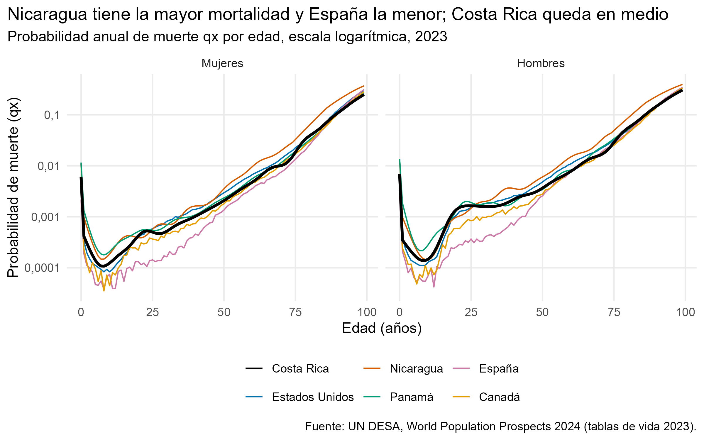
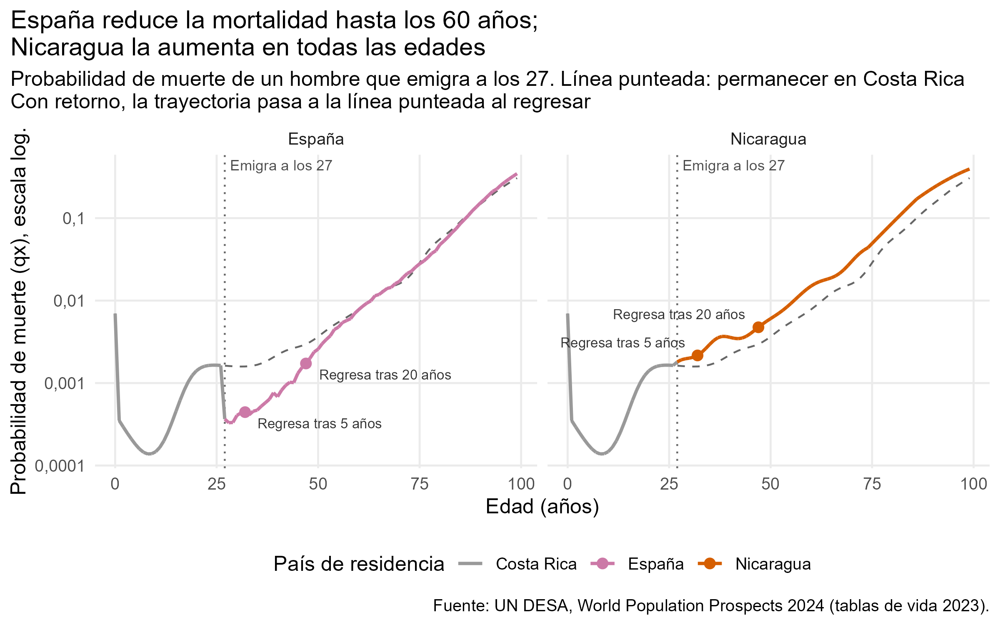
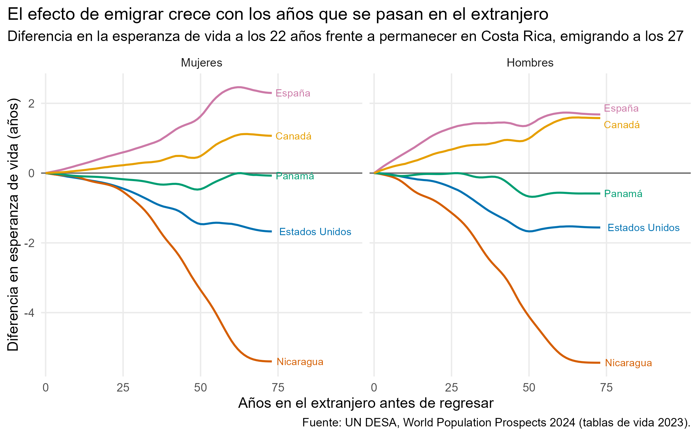

```{r}
#| label: preparacion

library(dplyr)
library(readr)
library(tidyr)

source("03_Funciones_actuariales.R")

tabla <- read_csv("../data/procesados/tablas_mortalidad_2023.csv",
                  show_col_types = FALSE)
resultados <- read_csv("../res/resultados_ejemplo.csv", show_col_types = FALSE)

nombres.paises <- tibble(
  codigo = c(188, 840, 558, 591, 724, 124),
  nombre = c("Costa Rica", "Estados Unidos", "Nicaragua", "Panamá",
             "España", "Canadá")
)

formato <- function(x, digitos = 1) {
  formatC(x, format = "f", digits = digitos, decimal.mark = ",")
}
```

# Objetivo

Comparar, mediante un modelo actuarial programado en R, la probabilidad de supervivencia y la esperanza de vida restante de una persona residente en Costa Rica bajo escenarios de permanencia en el país, emigración permanente y emigración temporal con retorno, hacia los cinco principales destinos de la emigración costarricense.

# Introducción

La emigración forma parte de la realidad de muchas familias costarricenses, ya sea que algunas personas se establecen de forma permanente en otro país o trabajan algunos años en el extranjero antes de regresar. Este proyecto estudia ese fenómeno desde la ciencia actuarial, con una pregunta concreta: ¿cómo cambiarían la supervivencia y la esperanza de vida de una persona si, durante cada etapa de su vida, estuviera expuesta a la mortalidad del país en el que reside?

El análisis se limita a la mortalidad, es decir, no evalúa ingresos, calidad de vida ni otros efectos de emigrar. Así, los resultados son comparaciones hipotéticas basadas en tablas de mortalidad poblacionales y no estiman el efecto causal de emigrar sobre una persona concreta.

# Datos

**Destinos de la emigración:** Se utilizó la base *International Migrant Stock 2020* de la División de Población de las Naciones Unidas (United Nations, 2020), que estima el número de personas nacidas en cada país que residen en otro a mitad de 2020. En principio se iba a utilizar la edición 2024, pero debido a que Estados Unidos reporta a Costa Rica dentro de un agregado de otros orígenes se impide identificar el principal corredor migratorio. Los cinco destinos con mayor número de emigrantes costarricenses en 2020 son Estados Unidos (96 903), Nicaragua (11 281), Panamá (9320), España (4505) y Canadá (4252).

**Mortalidad.** Se utilizaron las tablas de vida por edad simple (0 a 100+ años) y sexo de *World Population Prospects 2024* (United Nations, 2024), correspondientes a las estimaciones del año 2023 para Costa Rica y los cinco destinos. Esta fuente aplica una metodología común a todos los países, lo que permite compararlos, de cada tabla se extrajo la probabilidad anual de muerte $q_x$.

# Metodología

El procesamiento se realizó en R (R Core Team, 2025) con `readxl` y los paquetes de `tidyverse` (Wickham et al., 2019), en cinco scripts encadenados: (1) ranking de destinos a partir de la base de migración, (2) extracción de las tablas de mortalidad de los seis países, uniendo ambas bases mediante el código numérico de país de las Naciones Unidas (M49), (3) funciones actuariales, (4) cálculo de escenarios y (5) gráficos. El código se desarrolló con apoyo de un asistente de programación (Anthropic, 2026).

Sean $x$ la edad actual, $d$ los años que faltan para emigrar y $s$ los años en el extranjero. La trayectoria migratoria se modela asignando a cada edad $k$ la probabilidad de muerte del país donde reside la persona (Bowers et al., 1997):

$$q_k^{M}=
\begin{cases}
q_k^{CR}, & k<x+d\\
q_k^{D}, & x+d\leq k<x+d+s\\
q_k^{CR}, & k\geq x+d+s
\end{cases}$$

donde $q_k^{CR}$ y $q_k^{D}$ son las probabilidades de Costa Rica y del destino respectivamente. La emigración permanente corresponde a $s=\infty$ y la permanencia en Costa Rica a $s=0$. La probabilidad de sobrevivir $t$ años y la esperanza de vida se calculan como

$${}_tp_x=\prod_{j=0}^{t-1}\left(1-q_{x+j}^{M}\right), \qquad
e_x=\sum_{t=1}^{\omega-x}{}_tp_x, \qquad
\Delta e_x=e_x^{M}-e_x^{CR}.$$

Se utiliza la **esperanza de vida curtata** (en años completos), con edad terminal $\omega=100$, por lo que sus valores son cerca de 0,5 años menores que la esperanza de vida completa que publican las Naciones Unidas. El modelo considera que la persona puede fallecer antes de emigrar, supone que los cambios de residencia ocurren en edades enteras y utiliza tablas de período de 2023, sin proyectar mejoras futuras de la mortalidad.

El caso de estudio es una persona de 22 años que emigra a los 27 ($x=22$, $d=5$), bajo cuatro alternativas: permanecer en Costa Rica, regresar tras 5 años, regresar tras 20 años y emigrar de forma permanente.

# Resultados

## Análisis exploratorio

La @fig-qx muestra que la mortalidad crece de forma aproximadamente exponencial con la edad en los seis países. Nicaragua presenta la mortalidad más alta en casi todas las edades adultas y España, la más baja; Costa Rica se ubica en una posición intermedia. Las mayores diferencias entre países aparecen entre los 25 y los 60 años, sobre todo en los hombres. La @tbl-esperanza resume estas diferencias, obteniendo que la esperanza de vida al nacer de Costa Rica es superior a la de Estados Unidos, Panamá y Nicaragua, e inferior a la de España y Canadá.

{#fig-qx width="72%"}

```{r}
#| label: tbl-esperanza
#| tbl-cap: "Esperanza de vida curtata a los 0, 22 y 65 años por país y sexo, 2023."

esperanzas <- expand_grid(codigo = nombres.paises$codigo,
                          sexo = c("Mujer", "Hombre")) %>%
  rowwise() %>%
  mutate(e0  = esperanza.vida(obtener.qx(tabla, codigo, sexo), 0),
         e22 = esperanza.vida(obtener.qx(tabla, codigo, sexo), 22),
         e65 = esperanza.vida(obtener.qx(tabla, codigo, sexo), 65)) %>%
  ungroup() %>%
  pivot_wider(names_from = sexo, values_from = c(e0, e22, e65)) %>%
  left_join(nombres.paises, by = "codigo") %>%
  transmute(País = nombre,
            `$e_0$ M` = formato(e0_Mujer),  `$e_0$ H` = formato(e0_Hombre),
            `$e_{22}$ M` = formato(e22_Mujer), `$e_{22}$ H` = formato(e22_Hombre),
            `$e_{65}$ M` = formato(e65_Mujer), `$e_{65}$ H` = formato(e65_Hombre))

knitr::kable(esperanzas, align = "lrrrrrr")
```

## Trayectorias migratorias

La @fig-trayectoria ilustra cómo opera el modelo para un hombre que emigra a los 27 años hacia los dos destinos extremos. Mientras reside en España su probabilidad de muerte es menor que en Costa Rica hasta cerca de los 60 años, a partir de esa edad ambas tablas son similares. En Nicaragua ocurre lo contrario, la mortalidad es mayor en todas las edades y la brecha se amplía en la vejez. En las alternativas con retorno, la trayectoria vuelve a la mortalidad costarricense al regresar.

{#fig-trayectoria width="72%"}

## Escenarios del caso de estudio

```{r}
#| label: tbl-escenarios
#| tbl-cap: "Diferencia en la esperanza de vida a los 22 años ($\\Delta e_{22}$, en años) frente a permanecer en Costa Rica, para una persona que emigra a los 27."

e.cr <- resultados %>%
  filter(alternativa == "Permanece en Costa Rica") %>%
  distinct(sexo, ex)

escenarios <- resultados %>%
  filter(alternativa != "Permanece en Costa Rica") %>%
  select(destino, sexo, alternativa, diferencia) %>%
  pivot_wider(names_from = alternativa, values_from = diferencia) %>%
  left_join(nombres.paises, by = c("destino" = "codigo")) %>%
  mutate(sexo = factor(sexo, levels = c("Mujer", "Hombre"),
                       labels = c("Mujeres", "Hombres"))) %>%
  arrange(sexo, desc(`Emigración permanente`)) %>%
  transmute(Sexo = as.character(sexo), Destino = nombre,
            `Retorno tras 5 años` = formato(`Retorno tras 5 años`, 2),
            `Retorno tras 20 años` = formato(`Retorno tras 20 años`, 2),
            `Emigración permanente` = formato(`Emigración permanente`, 2))

knitr::kable(escenarios, align = "llrrr")
```

Si permanece en Costa Rica, la esperanza de vida curtata a los 22 años es de `r formato(e.cr$ex[e.cr$sexo == "Mujer"], 2)` años para las mujeres y de `r formato(e.cr$ex[e.cr$sexo == "Hombre"], 2)` para los hombres. La @tbl-escenarios muestra que una estancia de 5 años en el extranjero casi no modifica este valor, la diferencia no supera 0,31 años en ningún destino. Con 20 años fuera el efecto crece, pero sigue siendo moderado, salvo en el caso de los hombres que emigran a España (+1,12) o a Nicaragua (−0,82). La emigración permanente produce los cambios más grandes, entre +2,30 años (mujeres, España) y −5,44 años (hombres, Nicaragua). Se obtiene que emigrar a España o Canadá aumenta la esperanza de vida, mientras que emigrar a Estados Unidos, Panamá o Nicaragua la reduce.

{#fig-sensibilidad width="72%"}

La @fig-sensibilidad generaliza este resultado para cualquier duración de la estancia. El efecto no depende solo de cuántos años se pasan fuera, sino de qué edades cubre la estancia. Las diferencias crecen con mayor rapidez cuando la residencia en el extranjero abarca las edades de 50 a 80 años, en las que la mortalidad es alta y las diferencias entre países pesan más.

# Conclusiones

1.  Bajo las tablas de mortalidad de 2023, emigrar de forma permanente a España o Canadá se asocia con una mayor esperanza de vida que permanecer en Costa Rica, mientras que emigrar a Estados Unidos, Panamá o Nicaragua se asocia con una menor, siendo Nicaragua el que representa el caso más desfavorable, con alrededor de 5,4 años menos.

2.  Las estancias cortas en edades jóvenes prácticamente no modifican la esperanza de vida, porque la mortalidad a esas edades es baja en todos los países. El efecto de emigrar depende de si la residencia en el extranjero cubre la edad adulta avanzada y la vejez.

3.  Estos resultados describen diferencias entre poblaciones y no predicciones individuales: las personas migrantes pueden tener características de salud distintas de las de la población del país receptor, por lo que el modelo debe interpretarse como una comparación hipotética y no como un efecto causal de emigrar.

\newpage

# Referencias {.unnumbered}

Anthropic. (2026). *Claude* (versión Claude Opus 5.5, mediante Claude Code) \[Modelo de lenguaje de gran tamaño\]. https://claude.ai

Bowers, N. L., Gerber, H. U., Hickman, J. C., Jones, D. A. y Nesbitt, C. J. (1997). *Actuarial mathematics* (2.ª ed.). Society of Actuaries.

R Core Team. (2025). *R: A language and environment for statistical computing* (versión 4.5.1) \[Software\]. R Foundation for Statistical Computing. https://www.R-project.org/

United Nations, Department of Economic and Social Affairs, Population Division. (2020). *International migrant stock 2020* \[Base de datos\]. https://www.un.org/development/desa/pd/content/international-migrant-stock

United Nations, Department of Economic and Social Affairs, Population Division. (2024). *World population prospects 2024* \[Base de datos\]. https://population.un.org/wpp/

Wickham, H., Averick, M., Bryan, J., Chang, W., McGowan, L. D., François, R., Grolemund, G., Hayes, A., Henry, L., Hester, J., Kuhn, M., Pedersen, T. L., Miller, E., Bache, S. M., Müller, K., Ooms, J., Robinson, D., Seidel, D. P., Spinu, V., … Yutani, H. (2019). Welcome to the tidyverse. *Journal of Open Source Software, 4*(43), 1686. https://doi.org/10.21105/joss.01686
